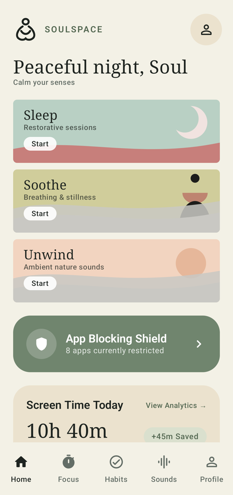
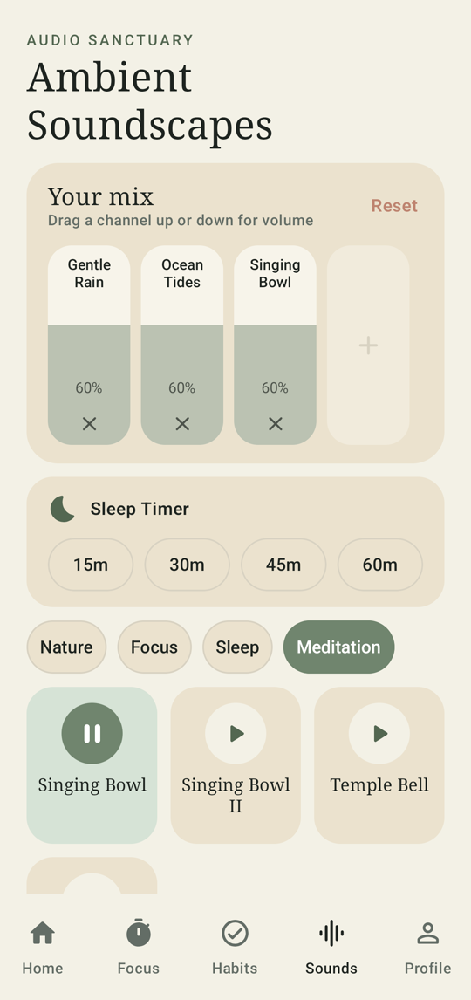
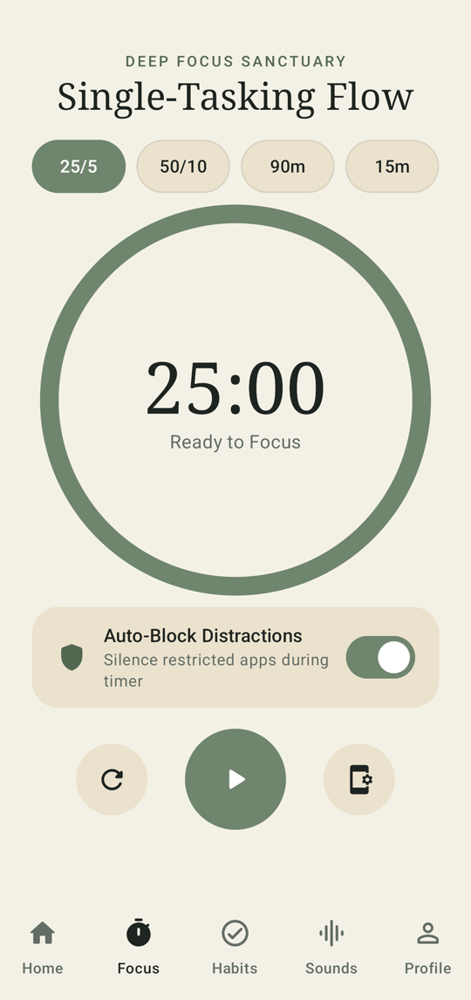
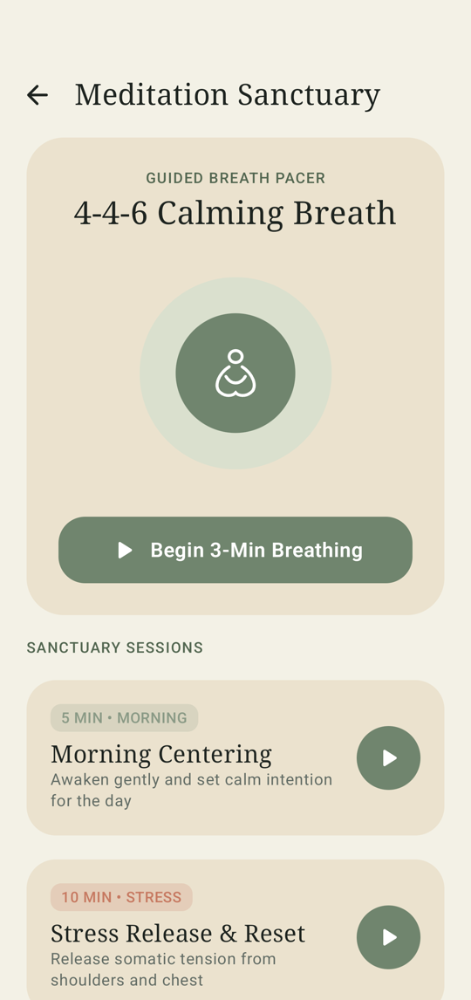
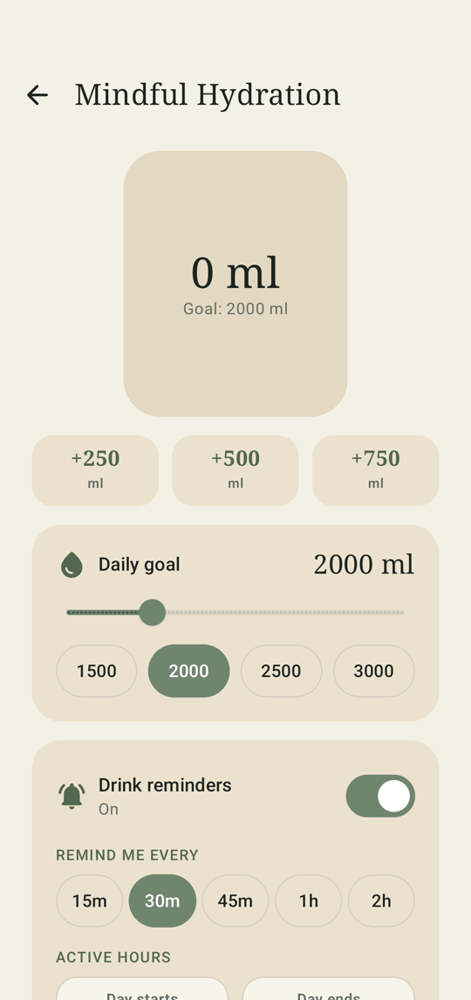
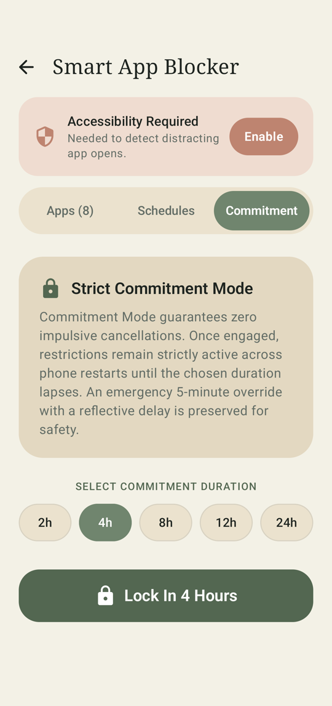
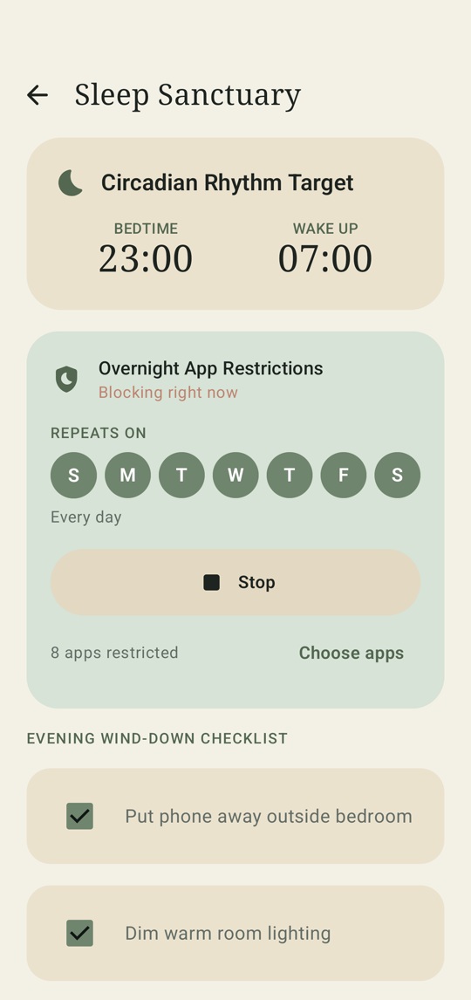

# SOULSPACE — Production Android Mobile Application

> *"Take back your time. Find your peace. Become your best self."*

**SOULSPACE** is an all-in-one personal digital wellness, productivity, meditation, habit-building, and self-discipline native Android application. It combines digital discipline tools (smart app blocking, focus timers, screen-time analytics) with restorative wellness (guided meditation, dynamic breathing pacer, ambient soundscapes, habit scaffolding, water logging, and circadian sleep design).

All core features are **100% free**, **offline-first**, and require **zero account registration**.

---

## Screenshots

<table>
  <tr>
    <td align="center"><br><sub><b>Home</b></sub></td>
    <td align="center"><br><sub><b>Sound mixer</b></sub></td>
    <td align="center"><br><sub><b>Focus timer</b></sub></td>
  </tr>
  <tr>
    <td align="center"><br><sub><b>Meditation</b></sub></td>
    <td align="center"><br><sub><b>Hydration</b></sub></td>
    <td align="center"><br><sub><b>App blocker</b></sub></td>
  </tr>
  <tr>
    <td align="center"><br><sub><b>Overnight restrictions</b></sub></td>
  </tr>
</table>

---

## Visual Design Philosophy (Zen Sanctuary)

Inspired by modern editorial typography, natural ceramics, and calm Japanese minimalism:
* **Color Palette:**
  * **Sanctuary Cream** (`#FBF9F4`) — Warm linen background
  * **Sanctuary Surface** (`#F4EFE6`) — Organic card surface
  * **Sage Primary** (`#70856E`) & **Olive** (`#67735E`) — Grounding natural greenery
  * **Terracotta Clay** (`#C77A62`) & **Soft Blush** (`#F0D5CD`) — Warm earth accents
  * **Deep Charcoal** (`#1E2420`) — Non-straining high-legibility text
  * **Night Forest** (`#111714`) — High-contrast dark mode
* **Art & Geometry:** Continuous single-line zen figure iconography drawn natively with Compose Canvas, organic wave curves, and soft rounded cards (`24.dp` – `28.dp`).

---

## Technology Stack & Architecture

* **Language:** Kotlin 2.0.0
* **UI Toolkit:** Jetpack Compose (Material 3, Edge-to-Edge)
* **Architecture:** MVVM + Clean Architecture with Kotlin Coroutines & Flow
* **Local Persistence:** Room Database 2.6.1 (pre-populated starter habits & schedules)
* **Preferences:** AndroidX DataStore (Preferences)
* **Audio Engine:** Media3 ExoPlayer 1.3.1 (`MediaSessionService`) with sleep timer fade-out
* **Background Tasks:** `AlarmManager` for exact RTC wakeup reminders, `WorkManager` for daily rollups
* **System Blocking & Metrics:** `AccessibilityService` (for sub-100ms window detection) & `UsageStatsManager` (for on-device screen analytics)

---

## Project Structure

```
com.soulspace.app/
├── SoulSpaceApp.kt                   # Application entrypoint & notification channel setup
├── MainActivity.kt                   # Single activity orchestrating edge-to-edge Compose
├── ui/
│   ├── theme/                       # Color, Type (Serif + Sans), Shape (22dp+), Theme
│   ├── navigation/                  # Bottom Navigation & Sub-module NavHost
│   ├── components/                  # Zen continuous-line icon, Canvas breathing pacer, charts
│   └── screens/
│       ├── home/                    # Sanctuary dashboard, greeting, quick actions
│       ├── blocker/                 # App list, temporary block, schedules, commitment mode
│       ├── focus/                   # Pomodoro circular timer, auto-lockdown toggle
│       ├── meditation/              # Paced breathing visualizer (4-4-6, 4-4-4-4, 4-7-8)
│       ├── sounds/                  # Nature, Focus, Sleep, Meditation ambient soundscapes
│       ├── habits/                  # Ritual tracker, streak calculation, 7-day dot matrix
│       ├── planner/                 # 24-hour chronological timetable & reminders
│       ├── wellness/                # Water tracker & Circadian sleep management
│       ├── analytics/               # On-device screen time rankings & weekly charts
│       └── profile/                 # Mindful points, badges, permissions, local data reset
├── data/
│   ├── local/                       # Room entities (Habits, BlockSchedules, Water, Focus) & DAOs
│   └── preferences/                 # DataStore preferences repository
├── service/
│   ├── AppBlockingAccessibilityService.kt # Real-time app launch detection
│   ├── LockoutActivity.kt           # Beautiful mindful restriction screen with reflection override
│   ├── AudioPlaybackService.kt      # Media3 background ambient sound engine
│   ├── BootCompletedReceiver.kt     # Re-schedules alarms & restarts blocks on device reboot
│   └── ExactAlarmReceiver.kt        # AlarmManager exact reminder receiver
└── util/
    ├── PermissionManager.kt         # Accessibility, UsageStats, Overlay helper
    ├── UsageStatsHelper.kt          # On-device screen-time aggregation
    └── NotificationHelper.kt        # Channels & exact alarm scheduler
```

---

## Core Feature Implementations

### 1. Smart App Blocking System (Priority Engine)
* **Application Detection:** `AppBlockingAccessibilityService` monitors `AccessibilityEvent.TYPE_WINDOW_STATE_CHANGED`. It checks whether the newly opened application matches an active temporary focus session or recurring schedule.
* **Overnight / Cross-Midnight Schedule Handling:** Accurately evaluates time spans that cross midnight (e.g. 11:00 PM to 7:00 AM) without timezone errors.
* **Lockout Sanctuary Screen:** When a restricted package is launched, `LockoutActivity` takes immediate foreground. It shows remaining block time, a comforting reminder, an integrated 1-minute breathing exercise, a "Return to Home" button, and a transparent **Emergency 5-Minute Override** requiring a 10-second reflective delay to eliminate impulsive cancellations.
* **Strict Commitment Mode:** Persists active restriction flags across device reboots via `BootCompletedReceiver`.

### 2. Digital Wellbeing & Screen-Time Analytics
* Queries Android's native `UsageStatsManager` to aggregate daily on-device usage, top applications, and category breakdowns (Social, Entertainment, Productivity).
* Visualized using custom Jetpack Compose Canvas bar charts.
* **Privacy Guarantee:** 100% on-device processing. No data is collected or sent to external servers.

### 3. Meditation Sanctuary & Dynamic Breathing Pacer
* **Breathing Visualizer:** Smooth expanding and contracting concentric rings drawn on Compose Canvas.
* **Configurable Pacing:** 
  * *4-4-6 Relax* (4s Inhale, 4s Hold, 6s Exhale)
  * *4-4-4-4 Box Breathing* (Focus & Nervous System Regulation)
  * *4-7-8 Deep Sleep* (Circadian Wind-Down)
* **Guided Stillness Sessions:** 5, 10, 15, and 20-minute presets with gentle Tibetan bells.

### 4. Relaxing Audio Library (Media3 ExoPlayer)
* Foreground `MediaSessionService` that supports continuous background playback even when the screen is locked.
* Integrated **Sleep Timer** with automated 60-second gentle volume fade-out.
* Categories:
  * **Nature:** Gentle Rain, Ocean Tides, Forest Ambience, Mountain Stream, Whispering Wind
  * **Focus:** Calibrated Brown Noise, White Noise, Ambient Drone
  * **Sleep:** Midnight Rain, Distant Thunder, Night Crickets
  * **Meditation:** Tibetan Singing Bowls, Zen Temple Bells, Deep Om Resonance

### 5. Focus Timer & Pomodoro
* Customizable intervals: 25/5 (Standard), 50/10 (Flow), 90-minute Deep Work, and Custom Sprints.
* Direct linkage with the Smart App Blocker: Automatically silences and locks chosen distracting apps during active sessions.

### 6. Habit Tracker, Timetable & Circadian Wellness
* **Habit Matrix:** Infinite habit creation with streaks, best records, and a 7-day consistency dot visualizer.
* **24-Hour Timetable:** Chronological daily planner with start/end time markers, category tags, and exact notifications via `AlarmManager`.
* **Mindful Hydration:** Animated fluid vessel showing water progress toward daily custom goals (logged in +250ml, +500ml, +750ml chips) with undo capability.
* **Sleep Routine:** Evening wind-down checklist combined with night-time app restriction scheduling.

---

## Build & Installation Instructions

### Prerequisites
* **Android Studio:** Hedgehog (2023.1.1) or Ladybug (2024.2.1+)
* **JDK:** Version 17
* **Android SDK:** Compile SDK 34, Min SDK 26

### Building from Android Studio
1. Open Android Studio.
2. Select **Open** and browse to this directory (`Do Not Distract`).
3. Allow Gradle to sync dependencies from Google & Maven Central.
4. Connect an Android device (or launch an Android 8.0+ emulator).
5. Click **Run** (`Shift + F10`) or navigate to `Build > Build Bundle(s) / APK(s) > Build APK(s)`.

### Building via Terminal
```powershell
# Generate Debug APK
./gradlew assembleDebug

# Generate Release APK
./gradlew assembleRelease
```
The compiled APK will be located in `app/build/outputs/apk/debug/app-debug.apk`.

---

## Permission Configuration & Policy Compliance

SoulSpace is built to strictly comply with Google Play Developer Policies:
* **Accessibility Service (`BIND_ACCESSIBILITY_SERVICE`):** Used exclusively to detect foreground window transitions for user-configured distracting apps. It does not inspect window content, record keystrokes, or intercept credentials. Prominent on-screen educational disclosures are provided before directing the user to system settings.
* **Usage Stats (`PACKAGE_USAGE_STATS`):** Required exclusively for compiling on-device screen time analytics.
* **Exact Alarms (`SCHEDULE_EXACT_ALARM` / `USE_EXACT_ALARM`):** Used to ensure time-critical notifications (meditation alarms, habit reminders, timetable activities) fire reliably when the device is idle or in Doze mode.
* **Safety Protocols:** System emergency calls (`911`, `112`, etc.), dialer applications, and critical system settings are never blocked.


---

## Building

Open the project in Android Studio, or from a terminal with JDK 17 and the Android SDK (platform 34) installed:

```
./gradlew assembleDebug
```

Create a `local.properties` file with `sdk.dir=<path to your Android SDK>` if your IDE has not already done so.

## Sound credits

The ambient soundscapes are real recordings from Wikimedia Commons (public domain, CC0 or CC BY), trimmed and looped by `tools/fetch_real_sounds.py`. They are **not** covered by the MIT licence below; each keeps its own licence. See [`app/src/main/assets/soundscapes/CREDITS.md`](app/src/main/assets/soundscapes/CREDITS.md) for authors and sources.

## License

The source code is released under the [MIT License](LICENSE).
